  <picture>
    <source media="(prefers-color-scheme: dark)" srcset="./assets/profile-banner-dark.svg" />
    <source media="(prefers-color-scheme: light)" srcset="./assets/profile-banner-light.svg" />
    
  </picture>

  

  <a href="https://patilsoham.com/?source=GithubReadme">Portfolio</a> &nbsp;|&nbsp;
  <a href="https://www.linkedin.com/in/sohampatil4101/">LinkedIn</a> &nbsp;|&nbsp;
  <a href="https://leetcode.com/u/soham4101/">LeetCode</a> &nbsp;|&nbsp;
  <a href="https://mail.google.com/mail/?view=cm&amp;fs=1&amp;to=patilsoham390%40gmail.com">Email</a>

  
  
  

## About

I’m a full-stack developer based in Mumbai, India. I build web applications across the stack, from React and Next.js interfaces to Node.js and Django services, REST APIs, and database-backed workflows. My projects cover local commerce, housing, transit, productivity, and warehouse operations.

**7+ hackathon wins** &nbsp;|&nbsp; **4+ finalist mentions**

## Selected work

<table>
  <tr>
    <td width="50%" valign="top">
      <h3><a href="https://github.com/sohampatil4101/VoloMart-Django">VoloMart</a></h3>
      
A Django marketplace for local vendors and locally made products.

      DJANGO &nbsp;|&nbsp; E-COMMERCE
    </td>
    <td width="50%" valign="top">
      <h3><a href="https://github.com/sohampatil4101/RoomBuddies-django">RoomBuddies</a></h3>
      
A Django platform for room listings and roommate matching.

      DJANGO &nbsp;|&nbsp; HOUSING
    </td>
  </tr>
  <tr>
    <td width="50%" valign="top">
      <h3><a href="https://github.com/sohampatil4101/Bus-Tracking-MERN-">TransitGo</a></h3>
      
A MERN app for tracking buses and trains in real time.

      MERN &nbsp;|&nbsp; MOBILITY
    </td>
    <td width="50%" valign="top">
      <h3><a href="https://github.com/sohampatil4101/Jarvis">Jarvis</a></h3>
      
A Python voice assistant for hands-free interaction.

      PYTHON &nbsp;|&nbsp; VOICE
    </td>
  </tr>
  <tr>
    <td width="50%" valign="top">
      <h3><a href="https://github.com/sohampatil4101/NotemakingApp_MERN">Note Making App</a></h3>
      
A MERN application for creating and managing notes.

      MERN &nbsp;|&nbsp; PRODUCTIVITY
    </td>
    <td width="50%" valign="top">
      <h3><a href="https://github.com/sohampatil4101/WarehouseManagementSystem-Django">Warehouse Manager</a></h3>
      
A Django system for inventory tracking and warehouse operations.

      DJANGO &nbsp;|&nbsp; OPERATIONS
    </td>
  </tr>
</table>

<a href="https://patilsoham.com/?source=GithubReadme"><strong>Explore more projects and live demos on my portfolio</strong>&nbsp;</a>

## Recognition

| Event | Result | Project |
|:--|:--|:--|
| **KRIYETA 3.0** | Winner | AI healthcare assistant for chronic patient support |
| **VNPS-24** | 1st place, National-Level Project Showcase | Telehealth access for rural communities |
| **LogiThon** | Finalist | Warehouse inventory and space optimization |

## Engineering toolkit

| Discipline | Focus |
|:--|:--|
| **Architecture** | System design, API design, modular architecture, performance, reliability |
| **Frontend engineering** | TypeScript, React, Next.js, Redux for state management |
| **Backend engineering** | Node.js, Express, Django, Python, REST API design |
| **Data** | MongoDB, PostgreSQL, MySQL |
| **Platform and delivery** | Docker, Git, GitHub, Vercel |

## What I’m focused on

- Shipping web applications with React, Next.js, Node.js, and Django
- Designing REST APIs and data models for product workflows
- Applying AI to healthcare and web applications

## Activity

  <picture>
    <source media="(prefers-color-scheme: dark)" srcset="https://raw.githubusercontent.com/sohampatil4101/sohampatil4101/output/github-contribution-grid-snake-dark.svg" />
    <source media="(prefers-color-scheme: light)" srcset="https://raw.githubusercontent.com/sohampatil4101/sohampatil4101/output/github-contribution-grid-snake.svg" />
    
  </picture>

  <picture>
    <source media="(prefers-color-scheme: dark)" srcset="https://streak-stats.demolab.com?user=sohampatil4101&amp;theme=transparent&amp;hide_border=true&amp;ring=D6B77A&amp;fire=D6B77A&amp;currStreakLabel=D6B77A&amp;sideLabels=A1A1AA&amp;dates=71717A&amp;currStreakNum=F5F5F4&amp;sideNums=F5F5F4" />
    <source media="(prefers-color-scheme: light)" srcset="https://streak-stats.demolab.com?user=sohampatil4101&amp;theme=transparent&amp;hide_border=true&amp;ring=8A6940&amp;fire=8A6940&amp;currStreakLabel=8A6940&amp;sideLabels=71717A&amp;dates=A1A1AA&amp;currStreakNum=27272A&amp;sideNums=27272A" />
    
  </picture>

  <strong>Project demos, work history, and contact details:</strong> 
  <a href="https://patilsoham.com/?source=GithubReadme">Visit my portfolio</a>&nbsp;

